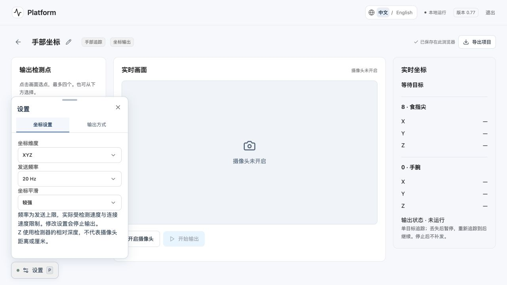

# Platform coordinate receivers / 坐标接收案例

Start with hand tracking, point 8 (index fingertip), XY, 10 Hz, smoothing light.
在 Platform 新建项目 → 动作追踪 → 手部 → 直接输出手部坐标。默认点 8 为食指尖。按 P 设置连接。先用“测试发送”，再开启摄像头与“开始输出”。没有目标时测试发送使用 0.5、0.5；此值只用于连接检查。

## Screenshots / 实际界面



## Message contract / 消息格式

XY follows the mirrored preview. X grows to the right, Y grows downward. Coordinates are normalized and clamped to 0–1. XYZ adds model-relative depth, not camera distance in centimeters. Hand depth is relative to the wrist, face depth to the head, pose depth to the hip center. At most four points are sent. Values are rounded to five decimals. Detection is single-target.
XY 与镜像画面一致，向右与向下增大，范围 0–1。Z 为模型相对深度，手、脸、身体各有自己的参考位置。最多输出四个点，保留五位小数，当前为单目标追踪。

Serial uses one UTF-8 JSON object per LF-terminated line. MQTT uses the same JSON in each message, default topic platform/coordinates. Example:
Serial 每行一帧 JSON，以 LF 结束；MQTT 每条消息一帧 JSON，默认主题 platform/coordinates。

```json
{"mode":"hand","t":12345,"points":[{"id":8,"x":0.42,"y":0.63,"z":-0.08}]}
```

The t field is sender-local monotonic milliseconds, not a synchronized clock. In XY mode the z field is absent. Configure mode and point ID in your receiver when switching to face (default 1) or pose (default 15).
t 是发送页的单调时钟毫秒，不用于跨电脑同步；XY 模式不带 z。切到脸或身体后，修改接收代码的 mode 和点编号，默认分别为 face/1、pose/15。

OSC uses base address /platform/hand, then adds the point ID. Example /platform/hand/8 has two float arguments (x y) or three (x y z). Face and pose default to /platform/face and /platform/pose. Port defaults to UDP 9000. Each point is a separate datagram, so multi-point OSC is not frame-atomic.
OSC 默认基础地址 /platform/hand，程序自动追加点编号。/platform/hand/8 带两个或三个浮点参数。脸与身体基础地址分别为 /platform/face、/platform/pose。每个点各一条消息，多点之间可能有 UDP 丢包或先后差异。

If any selected point is missing, out of confidence or lacks requested Z, the sender pauses the entire frame and resets smoothing. On recovery it resumes from current coordinates. No zero reset or loss message is sent. Receivers should expire values after 0.8 seconds (increase this if you import a slower rate). Never use the sender t as a receiver timeout clock.
任一选中点不可用时整帧暂停，恢复后从当前坐标继续；停止和丢失都不会发送零值。接收端建议按本机收到消息的时间设置 0.8 秒超时，低频项目自行加长，避免继续使用陈旧坐标。

## Processing

Open Processing/CoordinateReceiver/CoordinateReceiver.pde in Java mode. Install oscP5 in the library manager, run the sketch, select Platform OSC and use 127.0.0.1, 9000, /platform/hand. The dot follows the fingertip and disappears on timeout. Close other UDP 9000 listeners before running.
用 Java 模式打开 PDE，安装 oscP5。先运行接收草图，再在 Platform 测试发送。圆点随食指尖移动，超时后隐藏。

The sketch also includes Serial JSON parsing. Set USE_SERIAL=true and choose the receiving port from Serial.list(). The Serial library is bundled with Processing.
草图也带有 Serial 接收，可改 USE_SERIAL 与端口编号。两端需要真实可通信的链路，见下方 Serial 说明。
Official docs https://sojamo.de/libraries/oscP5/ and https://processing.org/reference/libraries/serial/index.html

## openFrameworks

Copy openFrameworks/CoordinateReceiver to apps/myApps. Use Project Generator to import/update it and enable ofxOsc (listed in addons.make). Build for your own OS, run, then use the same OSC settings as Processing. The dot disappears after 0.8 seconds without messages.
复制到 openFrameworks 的 apps/myApps，通过 Project Generator 导入并选择 ofxOsc，再为当前系统编译。运行后用 OSC 接收坐标。文件包提供源码工程，不含已编译应用。
Official docs https://openframeworks.cc/documentation/ofxOsc/ofxOscReceiver/

## Max / MSP

Open Max/CoordinateOSC.maxpat. It uses built-in udpreceive, route and unpack. No extra OSC external is required for this patch. Send to UDP 9000 and /platform/hand, point 8. X/Y/Z appear in number boxes. In XY mode ignore the Z box. Values hold when tracking stops; add a local timeout for installations.
打开 Max 工程，检查 udpreceive 9000 → route /platform/hand/8 → unpack f f f。XY 时只读前两个数框。该最小工程在停止后保留最后值，实际装置应自行加入超时判断。

Max/CoordinateSerial.maxpat uses serial and coordinate_serial.js. Click print to list ports, edit serial a 115200 to the receiving port, then enable polling. The four outputs are x, y, z, point ID. Keep the JS file beside the patch.
Serial 工程的四路输出为 x、y、z、点编号。先选接收端口，再打开轮询开关，JS 文件需与工程放在同一文件夹。
Official docs https://docs.cycling74.com/reference/udpreceive/ and https://docs.cycling74.com/reference/serial/

## p5.js

Serve the p5js folder over localhost (for example python3 -m http.server 8000), then open http://localhost:8000. The page loads p5.js and MQTT.js from a CDN, so the first load needs internet. Alternatively copy sketch.js into the p5 Web Editor and add the MQTT.js script from index.html to its HTML.
用本地静态服务器打开 p5js 文件夹，或复制到 p5 Web Editor，并在 index.html 加入 MQTT.js。首次加载库需联网。

Fill your own broker WSS URL, user, password and topic in both Platform and the receiver. Click Connect MQTT in the example, save/connect MQTT in Platform, then start output. Credentials stay in the inputs and are not embedded in the download. This example subscribes via WSS, because ordinary browser pages cannot listen on UDP. For OSC-to-p5 use a separate UDP-to-WebSocket bridge.
发送端与接收页连接同一个 Broker、使用同一 Topic，但 Client ID 须不同。HTTPS 页面使用 WSS。浏览器 p5.js 的示例通过 MQTT 接收；OSC 需要另外的 UDP 到 WebSocket 桥接。
Official docs https://p5js.org/ and https://github.com/mqttjs/MQTT.js

## TouchDesigner

### OSC
Create an OSC In CHOP. Set Network Port=9000, protocol UDP, Active on, and OSC Address Scope=/platform/hand/*. Use Platform OSC base /platform/hand and point 8. Click test send and inspect the channels received by OSC In CHOP. Use a Select CHOP to choose the channels for point 8 and a Rename CHOP to call them x/y/z. Channel suffixes can differ between TouchDesigner builds, so pick from the channels actually received. To move a TOP, map x to x-0.5 and y to 0.5-y in a Math/Expression CHOP and export to a Transform TOP.
创建 OSC In CHOP，UDP 9000，Address Scope 设为 /platform/hand/*。测试发送后查看真实通道名，再用 Select 和 Rename CHOP 选择并命名 x/y/z。TOP 位移通常以中心为原点且 Y 向上，按 x-0.5、0.5-y 转换后再连接 Transform TOP。

### MQTT
TouchDesigner has an MQTT Client DAT. Configure the broker TCP/TLS host and port using your broker's instructions, and credentials. This is normally a different endpoint from the WSS URL used by Platform. Create a Table DAT named coordinates beside the receiver. Paste coordinate_callbacks.py into its callbacks DAT. onConnect subscribes to platform/coordinates; onMessage fills the table. Use DAT to CHOP or expressions to read the point rows. The final column is the local received time. Add a local timeout before applying values to moving equipment.
TouchDesigner 支持 MQTT Client DAT。使用 Broker 的 TCP/TLS 端口，网页使用 WSS 端口，两者需分别填写。建立同级 coordinates Table DAT，粘贴附带回调脚本，连接后自动订阅并填表。最后一列记录接收时间，便于做超时处理。

### Serial
Create a Serial DAT, choose the receiving port and 115200 baud. Set one row per line with LF termination. Create the same coordinates Table DAT and use coordinate_callbacks.py as the Serial DAT callbacks. Its onReceive parses each JSON line. Match the callback signature to the template included with your TouchDesigner build if it differs.
建立 Serial DAT，设为按行接收、LF、115200。指定附带回调脚本并建立 coordinates 表。不同版本若回调签名变化，以软件自动生成的模板为准。
Official docs https://docs.derivative.ca/OSC_In_CHOP and https://docs.derivative.ca/MQTT_Client_DAT and https://docs.derivative.ca/Serial_DAT

## Serial connection topology / 串口链路

A serial port is normally exclusive. Platform and the receiving desktop software cannot both open the same USB port. To connect two applications on one computer, use an OS-provided/configured virtual serial pair, with one end in each application, or an external device that forwards bytes between two ports. Web Serial may not expose every virtual port, depending on OS and driver. OSC is the direct same-computer route for the included desktop examples.
同一个 USB 串口通常只能由一个程序占用。两个软件需要虚拟串口对（各用一端）或设备转发；Web Serial 是否能列出虚拟端口取决于系统与驱动。先确认真实链路再选 Serial。

## Verification status / 验证状态

Platform coordinate math, rate limiting, missing-target handling and OSC UDP packet bytes are checked with synthetic points and local receivers. The patches and source projects are provided for receiver-side testing. No real-device installation/compile test in Processing, openFrameworks, Max or TouchDesigner has been claimed. Test credentials, screenshots of real tracking and actual software captures must be collected in your own test session.
已用合成坐标与本机 UDP 接收端验证 Platform 消息格式、限速和丢失处理。五种软件的工程供用户接收端验收；尚未宣称在这些软件中完成实机编译运行。请记录软件版本、输入模式、消息内容与实际结果。
